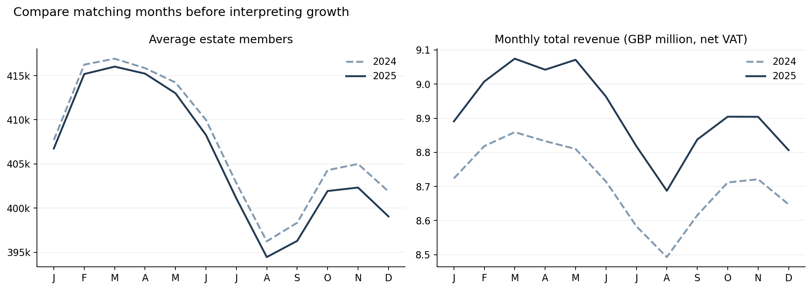
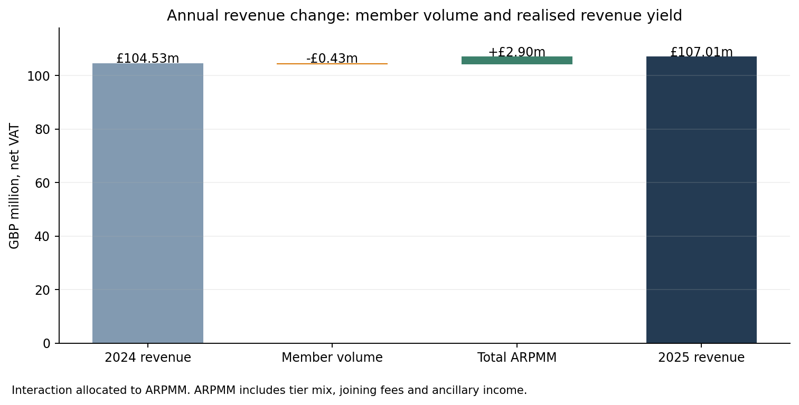
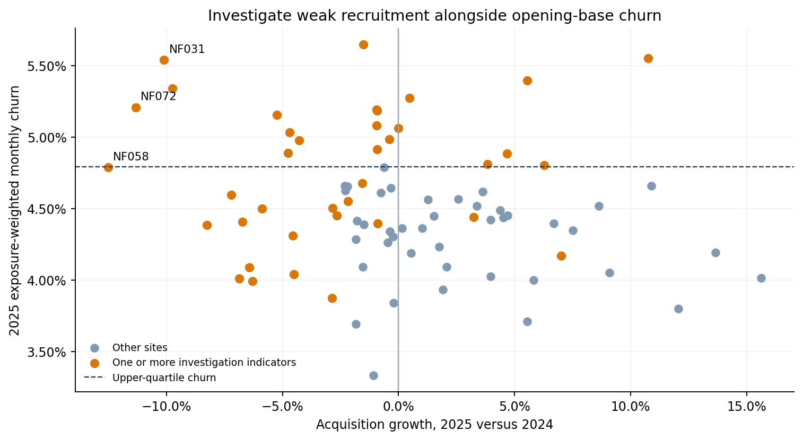

# Northstar Fitness — Commercial Baseline

This project uses synthetic data and is inspired by the commercial economics of UK subscription fitness businesses.

## Business purpose

Assess 2025 revenue, membership, acquisition, retention and capacity before evaluating further Standard price increases. Higher realised yield can outweigh weaker member performance, but the annual result must be examined alongside recent trading. This baseline directs investigation and Phase 4 headroom analysis. It does not estimate causal price effects or assign site actions.

## Estate results

| Measure | 2024 | 2025 | Change |
|---|---:|---:|---:|
| Total net revenue | £104,530,643 | £107,006,934 | 2.37% |
| Net subscription revenue | £100,730,862 | £103,181,994 | 2.43% |
| Net joining-fee revenue | £1,263,967 | £1,289,125 | 1.99% |
| Net ancillary revenue | £2,535,815 | £2,535,815 | 0.00% |
| Average members | 407,460 | 405,800 | -0.41% |
| Closing members | 399,002 | 396,311 | -0.67% |
| Acquisitions | 221,574 | 221,277 | -0.13% |
| Total ARPMM | £21.38 | £21.97 | 2.79% |
| Subscription yield | £20.60 | £21.19 | 2.85% |
| Standard subscription yield | £20.08 | £21.00 | 4.58% |
| Monthly churn | 4.47% | 4.52% | +0.05 pp |
| Conversion | 30.96% | 30.73% | -0.24 pp |

2025 net revenue changed by **£2,476,291 (2.37%)**. The exact descriptive bridge attributes -£425,764 to average member volume and £2,902,055 to total ARPMM. The latter includes membership mix, joining fees and ancillary income, with the interaction allocated to ARPMM. It is not a causal measure of repricing benefit.

2025 membership moved from 399,002 opening to 396,311 closing, with 221,277 activations and 223,968 exits. Activations can include rejoiners. Neither summed monthly stocks nor activations are unique-customer counts.

## Recent trading

Q4 revenue changed 2.05% year on year, acquisitions changed -1.32%, and monthly opening-base churn changed +0.00 pp. December annualised revenue is £105,678,390, compared with actual 2025 revenue of £107,006,934. December × 12 is a seasonal run-rate illustration, not a forecast.

## Site comparisons

Revenue scale, revenue growth and member growth answer different questions. The following rankings use 2025 annual revenue, matching-year revenue growth, and 2025 opening-to-closing member growth. Ties resolve by gym ID.

### highest total revenue 2025

| Gym | City | Result |
|---|---|---:|
| NF004 | London | £2,664,228 |
| NF009 | London | £2,316,285 |
| NF011 | London | £2,299,294 |
| NF001 | London | £2,255,247 |
| NF052 | York | £1,966,986 |

### lowest total revenue 2025

| Gym | City | Result |
|---|---|---:|
| NF050 | Leeds | £723,262 |
| NF075 | Newport | £769,615 |
| NF027 | Exeter | £772,157 |
| NF035 | Preston | £802,350 |
| NF032 | Plymouth | £808,403 |

### highest revenue growth yoy

| Gym | City | Result |
|---|---|---:|
| NF022 | Southampton | 7.31% |
| NF045 | Leeds | 6.84% |
| NF015 | Oxford | 6.32% |
| NF028 | Plymouth | 5.98% |
| NF071 | Aberdeen | 5.82% |

### lowest revenue growth yoy

| Gym | City | Result |
|---|---|---:|
| NF008 | London | -1.50% |
| NF027 | Exeter | -1.25% |
| NF003 | London | -1.20% |
| NF005 | London | -0.82% |
| NF063 | Coventry | -0.61% |

### highest member growth 2025

| Gym | City | Result |
|---|---|---:|
| NF050 | Leeds | 5.11% |
| NF017 | Portsmouth | 4.07% |
| NF019 | Reading | 3.95% |
| NF025 | Bristol | 3.19% |
| NF055 | Birmingham | 2.92% |

### lowest member growth 2025

| Gym | City | Result |
|---|---|---:|
| NF058 | Coventry | -7.24% |
| NF031 | Exeter | -6.12% |
| NF052 | York | -4.80% |
| NF011 | London | -4.43% |
| NF036 | Bolton | -4.28% |

## Investigation indicators

- High churn: 20 sites at or above the 2025 upper quartile (4.79% monthly).
- Weak conversion: 20 sites at or below the lower quartile (29.63%).
- Declining acquisition: 20 sites with negative year-on-year growth at or below the lower quartile (-2.40%).
- Peak capacity: 2 sites with a monthly peak estimate at or above 100% of comfortable concurrent capacity.

Flags overlap and reflect relative estate performance. They are not pricing actions, headroom scores or rollout guardrails. Revenue growth alone does not establish that a site can sustain another increase. Historical targeted repricing and pilot assignments are visible as context, without estimating treatment effects here.

## Sites to investigate

- NF072 (Dundee): acquisitions changed -11.33%, with 5.21% monthly churn. Review recruitment and retention together before assessing another increase.
- NF031 (Exeter): acquisitions changed -10.10%, with 5.54% monthly churn. Review recruitment and retention together before assessing another increase.
- NF052 (York): acquisitions changed -9.75%, with 5.34% monthly churn. Review recruitment and retention together before assessing another increase.
- NF002 (London): maximum monthly peak utilisation reached 104.67%. Review service capacity alongside pricing analysis.
- NF071 (Aberdeen): maximum monthly peak utilisation reached 100.00%. Review service capacity alongside pricing analysis.

Annual acquisition changed only slightly, while Q4 recruitment weakened more. This makes the recent-period comparison useful even though annual revenue increased. Neither pattern identifies the cause without subsequent historical-response analysis.

## Commercial visuals

Decision supported: establish whether changes persist across matching seasonal periods.

Decision supported: establish whether member volume or total realised yield explains the annual revenue change.

Decision supported: prioritise investigation of weaker recruitment and retention before assessing further price changes.

## Interpretation and limits

Churn is an opening-member-exposure-weighted monthly rate. Retention is one minus that monthly churn, not annual survival or cohort retention. Average members use monthly midpoint exposure. Average occupancy and estimated monthly peak occupancy measure different capacity conditions. Estate and regional occupancy are weighted by opening time and capacity. Complaints use average-member months as exposure.

Competitor gaps compare advertised recurring Standard prices including VAT, excluding joining fees and introductory promotions. All competitor observations are fictional. Revenue excludes assumed 20% VAT. Historical associations are descriptive and confounded by seasonality, marketing, promotions, competitor changes and tier mix. Revenue is not profit.

This project uses synthetic data created for portfolio purposes. It is inspired by the economics of multi-site subscription fitness businesses and does not use confidential information from The Gym Group or any other operator.

Phase 4 will assess pricing headroom using this baseline.
