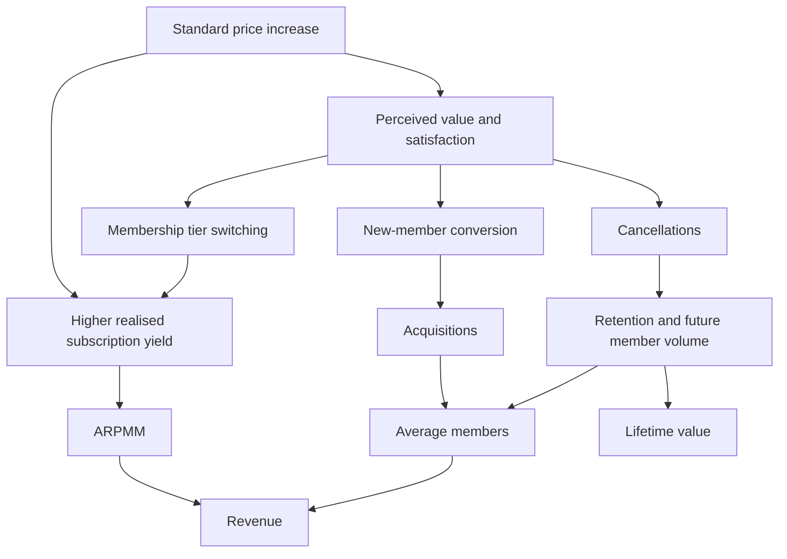

# UK Gym Pricing & Revenue Optimisation

## Identifying Site-Level Pricing Headroom Across an 80-Gym Estate

**Phase 1: Business Problem & Commercial Logic**  
**Operator:** Northstar Fitness — fictional UK low-cost gym company  
**Audience:** Pricing Manager, Commercial Director and CFO  
**Decision horizon:** 12 months from the proposed intervention  
**Status:** Phase 1 complete; dataset generation and financial findings pending

> This project uses synthetic data and is inspired by the commercial economics of UK subscription fitness businesses.

## 1. Management brief

Management is considering increasing Standard membership prices across some or all of 80 mature gyms. The estate is designed to contain approximately 400,000 members across Standard, Off-Peak and Plus memberships, with variation in regional demand, income, competition, student mix and capacity pressure. The member total is a design assumption, not an analysed result. Phase 2 will calculate the actual synthetic estate size.

The central question is:

> Can we increase Standard membership prices across 80 mature gyms without destroying enough member volume to offset the additional revenue?

The practical decision is **which gyms should increase prices, by how much, and under what conditions additional revenue outweighs lost member volume**. The objective is sustainable revenue growth while protecting economically valuable members. Neither maximising price nor maximising membership alone is the objective.

For this project, a mature gym has been open for at least 24 months at the start of the historical observation period. The same 80 gyms remain in the analysis; new-site ramp-up is outside the decision boundary. Competitors will be fictional operators representing national low-cost and local alternatives. No Northstar observations will be attributed to a real operator.

### What this phase does

| Question | Phase 1 answer |
| --- | --- |
| What am I doing? | Defining a site-level Standard pricing decision and the membership and revenue mechanics required to evaluate it. |
| Why am I doing it? | Higher yield can be offset by weaker acquisition, higher cancellations or migration into cheaper tiers. |
| What would a real Pricing Analyst try to learn? | Where additional yield plausibly outweighs behavioural losses, and which assumptions require a controlled test. |
| What business decision does this support? | Which gyms to raise, test, hold or investigate, followed by an evidence-based rollout decision. |

No gym recommendations, elasticity estimates, revenue uplift or treatment results have been calculated in Phase 1.

## 2. How price changes commercial performance



**Decision supported by this diagram:** assess yield and member behaviour together before recommending an increase. The arrows describe possible mechanisms; they do not establish the size or causality of a response.

A higher price may reduce conversion among prospects and increase cancellation among existing members. It may also cause Standard members to downgrade to Off-Peak. Conversely, fewer members at an overcrowded gym may improve the experience for those who remain. These effects can differ by gym and unfold over several months.

Headline Standard price is the advertised consumer price. It is not realised ARPMM: discounts, legacy rates, tier mix, joining fees and ancillary income affect realised revenue. Public operator reporting defines ARPMM using revenue and average members, and discusses both headline pricing and existing-member repricing as yield drivers. This is commercial context, not Northstar data. [Source: The Gym Group, Our Performance, accessed 4 October 2026](https://www.tggplc.com/investors/our-performance/).

## 3. Monthly member and revenue model

Use the gym-month as the primary unit of analysis and retain membership-tier detail underneath it. Members are active memberships assigned to a home gym, counted once across the estate. Prices and fees are in GBP.

### Member movement

```text
Closing members = Opening members + New members - Cancelled members
Next month's opening members = This month's closing members
Average members ≈ (Opening members + Closing members) / 2
```

The average is a monthly approximation. It assumes activity is spread sufficiently evenly through the month; actual billable exposure can differ when joining and cancellation timing is concentrated. Validate this approximation when designing the dataset.

At tier level, add transfers in and subtract transfers out. A Standard-to-Off-Peak move is a tier transfer, not an acquisition or cancellation. Transfers cancel out at gym level. The initial project assumes no cross-gym transfers or membership freezes, so the estate bridge remains reconcilable without additional movement terms.

### Revenue and yield

```text
Subscription revenue = Sum across tiers of:
                       Average tier members × Realised monthly tier yield

Total gym revenue = Subscription revenue
                  + Joining fee revenue
                  + Ancillary revenue

Subscription yield per member = Subscription revenue / Average members
ARPMM = Total gym revenue / Average members
Total gym revenue = Average members × ARPMM
```

Realised tier yield is net subscription revenue per average tier member. It reflects paid rates, promotional discounts and any billing-timing adjustment. Do not apply those adjustments again after using realised yield.

Model joining fee revenue as actual new joins multiplied by the realised net joining fee, allowing for waivers. Use recognition in the joining month as an explicit portfolio simplification, rather than claiming to reproduce a real operator's accounting policy. Keep joining fee policy unchanged between price scenarios.

Ancillary revenue must be visible as a separate line. For the first scenario model, hold its site-specific seasonal baseline equal across scenarios; do not attribute unrelated ancillary growth to a Standard price increase. Member-sensitive ancillary response can be evaluated as a later sensitivity.

Consumer membership and competitor prices include VAT. For the fictional model, assume all included revenue categories are subject to 20% VAT:

```text
Net revenue amount = VAT-inclusive amount / 1.20
```

Apply this assumption to membership income, joining fees and ancillary receipts consistently. This is a modelling convention, not tax guidance. Report revenue net of VAT and compare advertised competitor prices on the same VAT-inclusive basis. A £1 consumer-price increase is approximately £0.8333 additional net yield per fully exposed member-month, before behavioural changes or discounts.

Marketing spend and operating costs are outside revenue. They remain important confounders and commercial considerations. A revenue gain must not be described as an equal profit gain. Contribution-based lifetime value will require cost and retention assumptions later.

## 4. Metric definitions

| Metric | Definition and interpretation |
| --- | --- |
| Opening / closing members | Active memberships at the start / end of the month. |
| New members | Membership activations during the month, including rejoiners; exclude tier transfers. |
| Cancelled members | Membership exits effective during the month, including same-month join-and-exit members; exclude tier transfers. |
| Average members | Opening-plus-closing midpoint; an approximation to member-month exposure. |
| Acquisition rate | New members divided by opening members; measures inflow relative to the installed base. |
| Conversion rate | New members divided by unique qualified prospects in a consistently defined monthly conversion funnel. Prospect counts must cover joining channels and include joiners; trials are a subset, not an extra denominator to add. |
| Opening-base churn rate | Members active at month start who exit during the month, divided by opening members. Same-month join-and-exit members are included in the member bridge but excluded from this rate. |
| Opening-base retention rate | One minus opening-base churn; not a measure of the retention of new joiner cohorts. |
| Cohort retention | Joiners still active at the stated observation age divided by original joiners; report only sufficiently observed cohorts. |
| Member growth | Closing members divided by opening members, minus one. |
| Headline Standard price | Advertised VAT-inclusive recurring price for a new Standard member, excluding joining fees. |
| Realised subscription yield | Net subscription revenue divided by average members; retain a tier-specific version. |
| ARPMM / revenue per member | Net total gym revenue divided by average members; includes separately disclosed fees and ancillary income. |
| Competitor price gap | Comparable local competitor Standard price minus Northstar headline Standard price; a positive gap indicates Northstar is cheaper. Match access and features, and disclose fees and promotions separately. |
| Utilisation | Average concurrent attendance divided by the gym's concurrent-capacity proxy; memberships divided by capacity is not attendance utilisation. |
| Peak utilisation | Peak-period concurrent attendance divided by the same capacity proxy; retain the definition of peak periods consistently. |
| Acquisition elasticity | Percentage change in acquisition divided by percentage change in the relevant new-joiner price, after attempting to account for other influences. |
| Churn response | Change in opening-base churn in percentage points, modelled separately from acquisition elasticity. |
| Complaint rate | Pricing-related complaints per 1,000 average members; define collection coverage consistently. |

Return a missing value, with an explanatory flag, when a denominator is zero. Do not silently convert missing observations into zero performance.

Aggregate revenue and membership counts across gyms before calculating estate ARPMM and rates. Do not take unweighted averages of gym ratios. Preserve counts behind every rate so SQL, Excel and dashboard outputs can reconcile.

## 5. Agreed pricing policy

Compare **no increase, +£1, +£2 and +£3**, where increments refer to the monthly VAT-inclusive Standard price.

- **New Standard joiners:** the increased headline price applies from the intervention date, subject to unchanged promotional terms.
- **Existing eligible Standard members:** apply the same cash increment to their own billed price after one full month's notice. Existing price differences remain; a member on a legacy rate is not automatically moved to the new headline price.
- **Timing convention:** use month-start intervention dates. Existing members are notified at the start of month 1 and reprice from the start of month 2. Potential notification-related cancellations can begin in month 1.
- **Active promotions:** honour promised promotional charges until expiry. Reprice existing promotional members only after both the notice period and price protection have ended. An existing member receives the scenario increment once; a new member joining on the new price must not receive it again.
- **Other tiers:** Off-Peak and Plus headline prices remain unchanged. Allow tier migration to affect mix and yield, while tracking transfers separately from exits.
- **Fees and marketing:** keep policies and planned marketing equal across scenarios, with historical variation considered when estimating response.

The notice rule is a fictional operating assumption, not a statement of legal requirements or of any real operator's practice. The first model assumes rolling monthly memberships rather than fixed-term commitments.

## 6. Counterfactual and sustainable success

The no-increase counterfactual is a monthly forecast of how each gym would perform without the proposed intervention. It includes normal seasonality, baseline trend, planned marketing, scheduled promotion expiry and the same assumed competitor environment used in every scenario.

All scenarios begin from identical opening membership and commercial conditions. Apply the price and behaviour changes to that shared starting point, then carry each scenario's closing membership into its next month. Do not reset members to baseline every month or apply both an acquisition loss and an unrelated stock-elasticity loss to the same people.

The **primary success measure** is incremental cumulative 12-month total revenue:

```text
12-month incremental revenue = Sum over months 1–12 of:
                              Scenario revenue - No-increase revenue

Revenue uplift % = 12-month incremental revenue
                 / No-increase cumulative 12-month revenue

Month-12 member impact % = Scenario closing members at month 12
                         / No-increase closing members at month 12 - 1

Annualised exit run-rate revenue = Month-12 monthly revenue × 12
```

Annualised exit run-rate is a snapshot, not revenue earned during the year and not a seasonally adjusted next-year forecast. Report it separately.

Evaluate acquisition, conversion, opening-base churn, cohort retention, membership mix, complaints and peak utilisation alongside revenue. Review behaviour at 30, 90 and 180 days; notification effects and cohort deterioration may appear at different times.

Later scenarios will show base, upside and downside cases. Preserve regional and site differences rather than hiding weak sites behind a positive estate total. A single positive month, a higher ARPMM or lower crowding does not by itself establish sustainable success.

## 7. Break-even reasoning

For a simplified group in which every member pays the affected price throughout the comparison period:

```text
Break-even member retention ratio = Old price / New price
Break-even volume decline = 1 - Old price / New price
```

For £25 to £26:

```text
25 / 26 = 96.1538% retention
1 - 25 / 26 = 3.8462% allowable volume decline
```

**Teaching example:** 10,000 members at £25 generate £250,000 in monthly gross subscription receipts. At £26, approximately 9,615.38 member-months produce the same amount. Dividing both prices and receipts by 1.20 leaves the retention ratio unchanged.

This is a revenue break-even ratio, not a churn guardrail. It does not say the whole estate can lose 3.85% of members safely. Only Standard prices change; existing members reprice later; billed rates differ; promotions, tier migration and acquisition affect realised revenue. Calculate estate break-even using the full monthly model.

For another **illustrative example, not a Northstar finding**:

| Monthly consumer price | Members | Gross monthly subscription receipts |
| --- | ---: | ---: |
| £25 | 10,000 | £250,000 |
| £26 | 9,900 | £257,400 |
| £27 | 9,600 | £259,200 |
| £28 | 9,200 | £257,600 |

£27 produces the highest revenue among these examples. It is not proven optimal: future acquisition, delayed churn, lifetime value, competitor response and the customer experience could change the longer-term ranking.

## 8. Evidence and decision framework

Use transparent business-rule segmentation and a documented headroom score to support judgement. Select and test score weights after observing the synthetic evidence; do not choose them to manufacture a preferred recommendation.

| Evidence | What it helps establish | What it cannot establish alone |
| --- | --- | --- |
| Positive comparable competitor gap | Possible room to raise price while retaining relative value. | That members will tolerate an increase or competitors will hold prices. |
| Healthy utilisation | Demand strength and possible capacity scarcity. | A reason to raise prices regardless of service pressure. |
| Acquisition and conversion strength | Resilience of the recruitment funnel. | Causal evidence of low price sensitivity. |
| Low churn and sound cohort retention | Existing members appear to obtain continuing value. | That notification or later repricing will leave retention unchanged. |
| Income, student mix and market intensity | Plausible differences in sensitivity and seasonality. | A substitute for observed site behaviour. |
| Historical price response | Evidence for scenario assumptions and uncertainty. | Causality without credible controls and checks. |

An illustrative +8% price change and -3% acquisition response implies acquisition elasticity of -0.375. This describes the acquisition response in that comparison; it must not be applied as an immediate 3% loss of all members. Estimate existing-member churn response separately in percentage points and incorporate any response lag.

Historical analysis must consider seasonality, marketing, promotions, competition, customer mix, site differences and regression to the mean. Controlled testing will provide stronger evidence, subject to adequate matching or randomisation, power and contamination checks.

Eventual site recommendations will use the following action vocabulary:

| Action | Commercial meaning |
| --- | --- |
| RAISE £2 | £2 is the preferred conditional policy for a site with supporting evidence and acceptable downside. |
| RAISE £1 | A smaller preferred conditional policy balances yield and sensitivity. |
| TEST FIRST | The opportunity appears credible but uncertainty is material. |
| HOLD PRICE | Maintain Standard prices where upside is weak or behavioural risk outweighs it. |
| DEFENSIVE / INVESTIGATE | Diagnose acquisition, value, service or competitive problems before repricing. |

+£3 remains an analytical scenario. If it appears strongest, explain that result and consider a test; the action framework must not conceal it or force an immediate rollout.

All increase recommendations remain conditional on controlled pilot evidence before wider implementation. The later experiment phase will define numerical revenue, churn, acquisition and complaint thresholds before simulating results. Revenue improvement is necessary but insufficient: concerning retention trends, regional failures or service deterioration can justify extending, modifying or stopping the test.

## 9. Assumptions, limitations and handoff

| Agreed assumption | Implication for subsequent phases |
| --- | --- |
| 80 mature sites and approximately 400,000 members | Generate meaningful variation and report actual totals; do not treat the target as a measured result. |
| 24 historical months, monthly granularity | Choose and document dates in Phase 2; avoid mixing simulated future outcomes with historical observations. |
| Standard is the only tier repriced | Retain all-tier revenue and membership mix to expose dilution and cannibalisation. |
| Both new and existing Standard members are affected | Model immediate new-joiner pricing and delayed existing-member repricing separately. |
| One full month's notice; rolling monthly terms | Implement the fictional timing convention and honour promotional protection. |
| Uniform 20% VAT modelling convention | Compare gross consumer prices consistently and calculate net revenue consistently. |
| Joining fees recognised in joining month | Disclose this accounting simplification and separate fee revenue from subscription yield. |
| Ancillary baseline held equal across price scenarios | Isolate the membership decision; discuss member-sensitive ancillary effects as uncertainty. |
| No cross-gym transfers or freezes in the first model | Preserve the simple member bridge; do not present it as a complete real-world membership system. |
| Observational response informs assumptions | Label uncertainty, test sensitivities and avoid claiming causal validation. |

Lifetime value, complaints, delayed retention and competitor response matter to the recommendation. Define their evidence requirements in subsequent phases; do not manufacture conclusions before data exist. Revenue optimisation is not a complete profit or welfare optimisation.

### Phase 1 completion check

- [x] Management question, audience and commercial objective are defined.
- [x] Affected tiers and member populations are explicit.
- [x] New-joiner and existing-member pricing timing is defined.
- [x] Promotions, legacy rates and tier switching are addressed.
- [x] Member movement and revenue equations reconcile conceptually.
- [x] Revenue boundary, VAT convention and weighted metric definitions are explicit.
- [x] Counterfactual, 12-month horizon and success measures are defined.
- [x] Break-even logic distinguishes a teaching example from the estate decision.
- [x] Acquisition elasticity is separate from existing-member churn response.
- [x] Decision actions and the controlled-testing requirement are established.
- [x] Synthetic assumptions and illustrative figures are distinguished from findings.

**Phase 1 is complete.** The next phase will design and generate the synthetic evidence needed to answer this brief. No dataset, site recommendation or financial result has been generated here, and Phase 2 has not started.

> This project uses synthetic data created for portfolio purposes. It is inspired by the economics of multi-site subscription fitness businesses and does not use confidential information from The Gym Group or any other operator.
