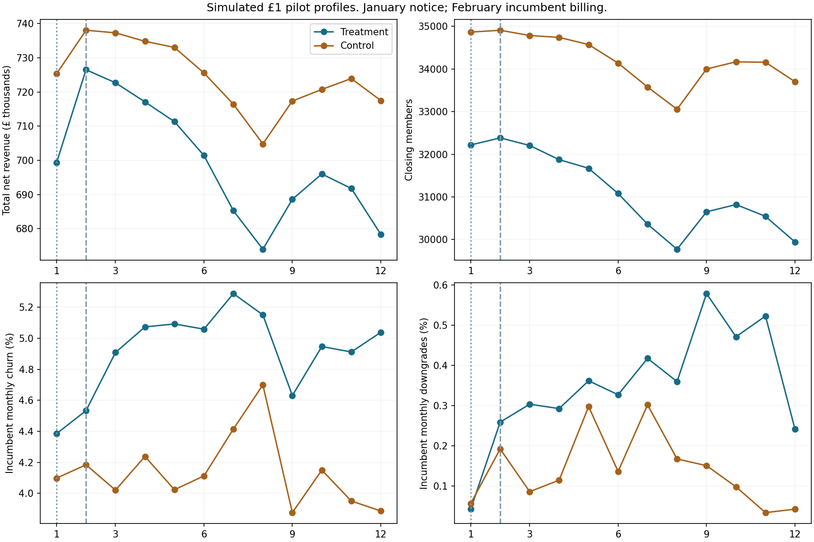
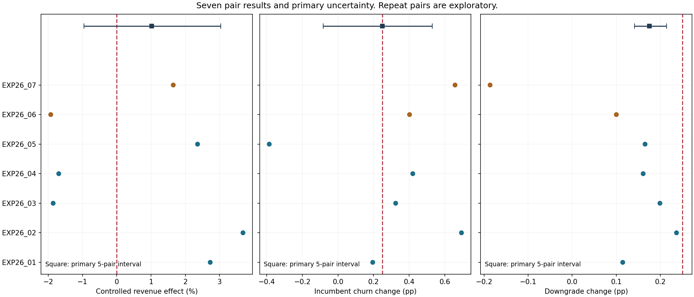
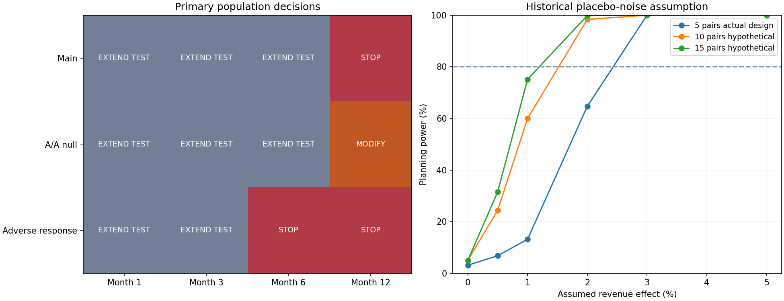

# Northstar Fitness — controlled £1 pricing pilot

This project uses synthetic data and is inspired by the commercial economics of UK subscription fitness businesses.

This project uses synthetic data created for portfolio purposes. It is inspired by the economics of multi-site subscription fitness businesses and does not use confidential information from The Gym Group or any other operator.

Phase 8 designs a small matched-pair experiment and demonstrates its analysis using simulated results. It supports a controlled commercial decision about whether yield gains compensate for recruitment, retention and tier-migration losses. It does not supply independent evidence validating Phase 6 or change Phase 7 actions.

## Main six-month result: EXTEND TEST

The five primary first-repricing pairs show controlled net revenue 1.02% (95% interval -0.96% to 3.03%), estimated cumulative cash difference £26,538 (interval £-31,554–£83,004). One-sided exact assignment p = 0.18750. These are simulated control-derived six-month results, not realised revenue or profit.

| Measure | Point | 95% interval | Limit |
|---|---:|---:|---:|
| member harm | 2.05% | 0.30% to 3.81% | 3.00% |
| standard acquisition harm | 5.27% | -1.00% to 11.15% | 10.00% |
| incumbent churn change pp | 0.249 pp | -0.083 pp to 0.530 pp | 0.250 pp |
| incumbent downgrade change pp | 0.175 pp | 0.142 pp to 0.214 pp | 0.250 pp |

Rule: D5_INCONCLUSIVE. Service trigger: False. Qualification requires confidence bounds, not just positive revenue. The 3% member, 10% Standard acquisition and +0.25 pp churn/downgrade tolerances are Phase 8 management assumptions, distinct from Phase 7 gates.

## Design and limits

Fourteen gyms form seven same-region, same-prior-repricing pairs: five first-repricing pairs are primary; two repeat pairs exploratory. Seven gyms receive £1 and seven remain unchanged. NF023 Portsmouth and NF057 Leicester are reserves because they lack a partner in their strict stratum. Eligibility and matching use only data available by December 2025. £2 is not tested. Controls remain unchanged through December 2026, even if a six-month decision supports conditional progression elsewhere.

New Standard prices and notice begin 1 January 2026. Eligible incumbents change on 1 February or at protection expiry. Legacy paid-rate differences and historical obligations persist. Churn, acquisition and downgrades are separate channels; joining-month downgrades are not incumbent responses. Off-Peak and Plus prices stay fixed.

## Decisions by simulation

| Simulation | Month 1 | Month 3 | Month 6 | Month 12 |
|---|---|---|---|---|
| Main | EXTEND TEST | EXTEND TEST | EXTEND TEST | STOP |
| A/A null | EXTEND TEST | EXTEND TEST | EXTEND TEST | MODIFY |
| Adverse response | EXTEND TEST | EXTEND TEST | STOP | STOP |

## Power and uncertainty

At an assumed 2% revenue effect, planning power is 64.7%. The estimated 80%-power detectable effect is 2.74%. Noise is a proxy from twelve historical pre-intervention pair comparisons, not the new experiment’s observed outcome. The one-sided test has 32 assignment flips and minimum p = 3.125%; the minimum two-sided p is 6.25%. Small-sample bootstrap ranges and transport remain uncertain. Repeat pairs and regions have fewer than four pairs: intervals remain unavailable, and they cannot authorise rollout.

Historical parameter uncertainty is the Phase 5/6 uncertainty in assumed effects. Simulated variation is the regional/site trading noise and integer customer-flow sampling. Experimental intervals resample the seven or five observed simulated pairs. They are different distributions. Known simulated no-increase paths are diagnostics and are excluded from the estimator. All A/A paths exactly equal those diagnostic no-increase paths; ordinary treatment/control A/A estimates can still be noisy. The twelve-month A/A MODIFY classification arises from member-loss and churn point estimates under baseline extrapolation and simulated trading variation, despite a known zero policy effect. It is a review signal, not evidence that an unchanged price caused harm. The main twelve-month STOP is driven by the incumbent-churn lower bound of +0.315 pp exceeding the +0.250 pp tolerance; its revenue interval remains inconclusive.

Service review triggers are controlled complaints above two per 1,000 member-months or capacity at/above 100% for two consecutive months in either arm. These flag service investigation, not causal attribution. Competitor recurring prices are frozen in the main simulation; actual competitor reaction and treatment contamination require monitoring in a real pilot.

ROLL OUT permits conditional £1 progression only for comparable first-repricing sites, retaining study controls. Missing evidence extends the test; confirmed harm or no gain stops; unresolved service/point harm modifies. No early review, repeat subgroup, A/A path or pooled supporting result licenses rollout.

## Commercial visuals

Profiles distinguish immediate joining prices from delayed incumbent billing and show why revenue and member trends can diverge. Raw arm totals are not controlled estimates.

Pair variation and primary intervals show financial and behavioural uncertainty. Pair dots are not reliable standalone gym causal estimates.

Checkpoint decisions and planning power expose conditions under which a small pilot remains inconclusive. Larger-sample calculations do not invent additional eligible sites.

## Delivery and completion

Rows: experiment_design: 80, experiment_monthly: 756, experiment_pair_results: 84, experiment_estimates: 1,728, experiment_power: 114, experiment_monitoring: 168, experiment_simulation_ledger: 61,934.
Python validation: 5443 checks passed. Earlier evidence hashes unchanged. The 31-sheet workbook passes saved-file recalculation, Python parity, refresh/stale tests, preservation and visual review; see experiment_workbook_verification.json. Phase 8 is complete.

Monthly membership figures are stocks, not unique customers. Monthly churn is not annual retention. Revenue is net of assumed 20% VAT and is not profit. Historical observations are repeated across simulation labels; do not sum across labels. Simulated post-period integer flows do not replace Phase 6 fractional expected forecasts.

Phase 8 is complete. Phase 9 is next: the Power BI communication layer.
