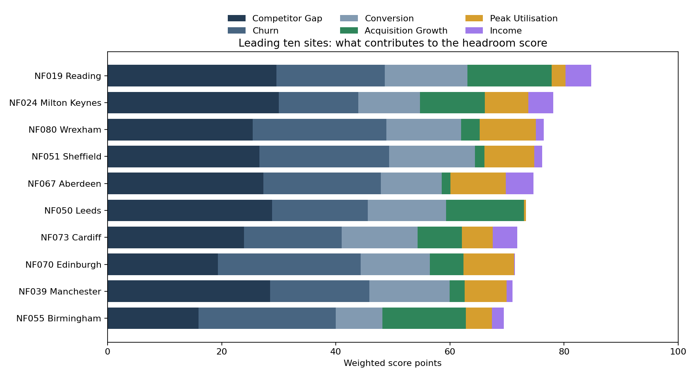
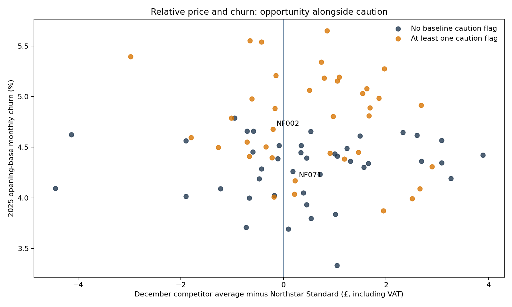
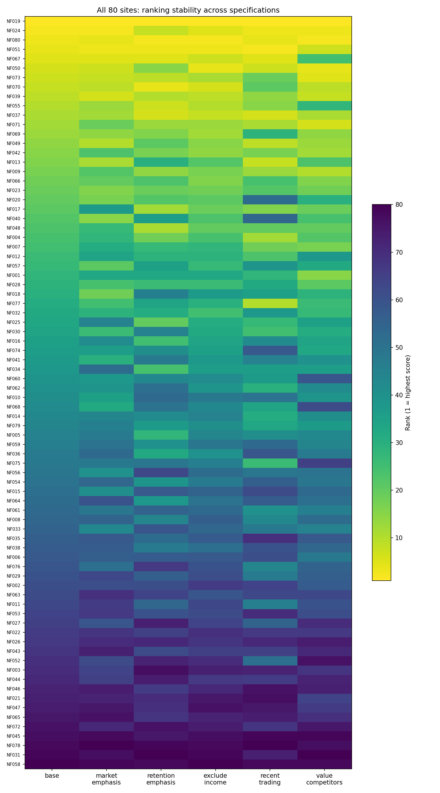

# Northstar Fitness — Pricing Headroom

This project uses synthetic data and is inspired by the commercial economics of UK subscription fitness businesses.

## Commercial purpose

Compare relative value, acquisition, retention and demand to identify sites deserving closer historical-response analysis. A high score can coexist with weak member performance. This assessment supports investigation priorities; it does not establish willingness to pay, causal price sensitivity, a cash increase or revenue uplift.

## Findings

The 80 gyms have scores from 16.14 to 84.75. Score bands: {'Medium': 43, 'Low': 22, 'High': 15}. Commercial segments: {'Investigation priority': 38, 'Mixed indicators': 16, 'Limited headroom indicators': 16, 'Stronger headroom indicators': 10}. 5 High-score gyms retain caution flags. 51 sites change band or move at least ten ranks under an alternative. 27 change band when thresholds move five points. Rankings should therefore guide subsequent evidence gathering rather than determine a rollout.

| gym_id | city | score | band | segment | max_absolute_rank_movement |
|---|---|---|---|---|---|
| NF019 | Reading | 84.75 | High | Stronger headroom indicators | 0 |
| NF024 | Milton Keynes | 78.1 | High | Stronger headroom indicators | 6 |
| NF080 | Wrexham | 76.46 | High | Investigation priority | 1 |
| NF051 | Sheffield | 76.14 | High | Investigation priority | 3 |
| NF067 | Aberdeen | 74.62 | High | Investigation priority | 20 |
| NF050 | Leeds | 73.35 | High | Stronger headroom indicators | 9 |
| NF073 | Cardiff | 71.77 | High | Stronger headroom indicators | 12 |
| NF070 | Edinburgh | 71.39 | High | Stronger headroom indicators | 13 |
| NF039 | Manchester | 70.95 | High | Investigation priority | 5 |
| NF055 | Birmingham | 69.43 | High | Stronger headroom indicators | 18 |

The table shows leading scores, including adverse signals where present. It is not a list of sites to reprice.

## High scores with adverse evidence

| gym_id | city | score | explanation |
|---|---|---|---|
| NF039 | Manchester | 70.95 | Positive competitor gap. Declining acquisition. Historical sensitivity pending Phase 5. |
| NF051 | Sheffield | 76.14 | Positive competitor gap. Declining acquisition. Historical sensitivity pending Phase 5. |
| NF067 | Aberdeen | 74.62 | Positive competitor gap. Declining acquisition. Historical sensitivity pending Phase 5. |
| NF071 | Aberdeen | 67.15 | Positive competitor gap. Peak service pressure. Historical sensitivity pending Phase 5. |
| NF080 | Wrexham | 76.46 | Positive competitor gap. Declining acquisition. Historical sensitivity pending Phase 5. |

Q4 trading creates the largest ranking shift (32 places), with 19 band changes. Removing income changes two bands and moves ranks by at most seven places. Recent commercial performance therefore deserves particular attention before interpreting a high annual score.

## Score and judgement

Weights are competitor gap 30%, churn 25%, conversion 15%, acquisition growth 15%, average monthly peak utilisation 10% and synthetic income 5%. Relative value and retention receive most weight because price gains depend on continuing value; recruitment provides supporting evidence. Capacity and income receive lower weights because occupancy can mean service pressure and demographics are indirect proxies. Weights are business assumptions, not fitted coefficients or probability estimates.

Each indicator uses average percentile ranks across the 80 gyms. Churn is reversed; peak inputs are capped at 100%. A constant or singleton indicator scores 50, and missing required inputs leave the score unavailable. High starts at 65; Medium at 40. Thresholds are policy choices, not economic break-even points. Ties resolve by gym ID using unrounded scores. Risk flags do not change the score. The commercial segment gives investigation precedence to any of the four Phase 3 flags, then separates stronger, limited and mixed indicators.

## Robustness

| variant | band_changes | max_rank_movement | sensitive_sites |
|---|---|---|---|
| base | 0 | 0 | 0 |
| exclude_income | 2 | 7 | 2 |
| market_emphasis | 9 | 16 | 16 |
| recent_trading | 19 | 32 | 29 |
| retention_emphasis | 11 | 17 | 27 |
| value_competitors | 11 | 20 | 15 |

Recent trading uses exposure-weighted Q4 churn/conversion, matching-quarter acquisition growth, Q4 average monthly peak and the mean of three monthly competitor gaps. It does not pool all competitor records across the quarter, which would overweight months with more competitors. The value-only comparison excludes the fictional full-service archetype. A positive rank movement means a site moves down the ranking. Sensitivity measures specification dependence, not statistical confidence.

## Visual interpretation

Contributions explain what drives leading scores. They are score points, not financial gains.

The scatter shows all 80 gyms, with caution sites distinguished and peak-pressure sites labelled. Higher competitor gaps do not demonstrate lower price sensitivity.

The matrix shows all sites in base-rank order across all six variants. Rank is relative: one site can move because another site's inputs differ.

## Boundaries and next step

Competitor prices include VAT and exclude joining fees and one-off introductory discounts from recurring comparisons. All competitor archetypes are assumed comparable in the synthetic source design; actual access, service and brand comparability would need investigation. Quality, distance, fees and promotions remain source context. December gaps are snapshots; Q4 supplies a timing sensitivity. Income and student exposure are synthetic local proxies, not individual member characteristics. Marketing, promotions, membership mix, complaints, region and prior repricing remain visible context without causal attribution. Monthly churn is not annual retention. Member-months are not unique people. Historical price sensitivity is pending Phase 5.

This project uses synthetic data created for portfolio purposes. It is inspired by the economics of multi-site subscription fitness businesses and does not use confidential information from The Gym Group or any other operator.
