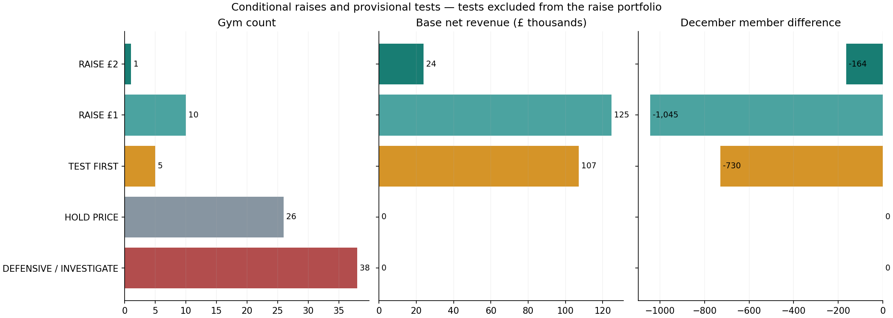
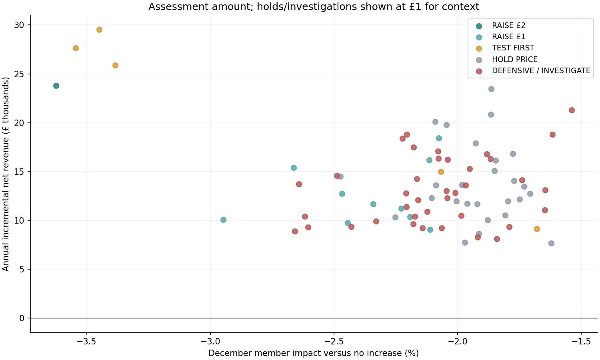
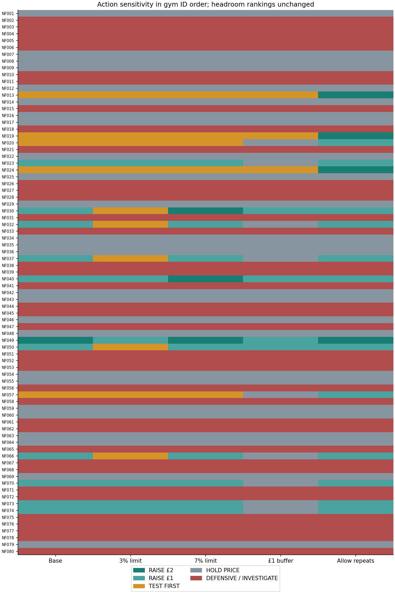

# Northstar Fitness — conditional gym recommendations

This project uses synthetic data and is inspired by the commercial economics of UK subscription fitness businesses.

This project uses synthetic data created for portfolio purposes. It is inspired by the economics of multi-site subscription fitness businesses and does not use confidential information from The Gym Group or any other operator.

Phase 7 combines relative value, existing commercial cautions and the historical-response scenario model. It supports conditional site decisions, protecting member volume while assessing revenue. This is a hypothetical January–December 2026 assessment, not an instruction to implement prices now.

## Recommendations

- **RAISE £2: 1 gym.**
- **RAISE £1: 10 gyms.**
- **TEST FIRST: 5 gyms.**
- **HOLD PRICE: 26 gyms.**
- **DEFENSIVE / INVESTIGATE: 38 gyms.**

The conditional RAISE portfolio adds **£148,618** annual net revenue in the Base case, with **-1,209** fewer December members (-0.31%) versus no increase. Conditional 95% parameter range: **£64,400–£230,752**. TEST FIRST opportunities are excluded; their provisional Base increments total £107,177. These are modelled outcomes, not earned revenue or profit.

The same shared pilot response drives every site. Site interval widths do not reflect locally identified elasticities. Positive parameter draws do not measure rollout probability. Future trading shocks, competitor reactions and transport uncertainty are excluded.

## Ordered policy

Any high churn, weak conversion, declining acquisition, peak-capacity flag or missing decision evidence requires investigation first. Compare £1/£2 candidates using positive Base revenue and the required post-increase competitor gap. Qualifying candidates also need positive Downside and conditional lower-bound revenue, no more than 5% Downside December member loss and positive revenue in all six nonzero-behaviour sensitivities. Select the higher qualifying Base revenue, favouring the smaller price on an exact tie. Repeat repricing goes to TEST FIRST. If only plausible candidates exist, provisionally test the smallest. If neither is plausible, HOLD PRICE.

The 5% member limit and financial gates are explicit management policy assumptions, not measured willingness to pay or Phase 8 rollout thresholds. Competitor gaps use VAT-inclusive recurring prices; joining fees and introductory discounts remain separate. Headroom bands and sensitivity remain context and are not causal evidence or new rankings.

## Portfolio and policy sensitivity

| Policy | £2 raises | £1 raises | Test | Hold | Investigate | Base annual increment | December member impact |
|---|---:|---:|---:|---:|---:|---:|---:|
| base | 1 | 10 | 5 | 26 | 38 | £148,618 | -0.31% |
| member_limit_3pct | 0 | 6 | 10 | 26 | 38 | £77,260 | -0.14% |
| member_limit_7pct | 3 | 8 | 5 | 26 | 38 | £172,299 | -0.36% |
| competitor_buffer_1gbp | 0 | 4 | 3 | 35 | 38 | £46,593 | -0.10% |
| allow_repeat_repricing | 4 | 12 | 0 | 26 | 38 | £255,796 | -0.49% |

- base: 0 action changes; 0 amount changes.
- member_limit_3pct: 6 action changes; 9 amount changes.
- member_limit_7pct: 2 action changes; 2 amount changes.
- competitor_buffer_1gbp: 10 action changes; 10 amount changes.
- allow_repeat_repricing: 5 action changes; 5 amount changes.

Limits of 3% and 7%, a £1 competitor buffer and allowing repeat repricing each change one policy assumption. These comparisons expose judgement sensitivity, not statistical confidence. No action category is forced to contain gyms.

## What remains uncertain

+£3 remains an analytical option and generally produces higher modelled revenue with greater membership loss. It is outside the action vocabulary. At 20 previously +£2 sites it makes Standard equal unchanged Plus; possible tier upgrades and value-proposition changes are unmodelled. £1 extrapolates from the observed +£2 pilot. All pilot pairs had positive pre-event competitor gaps. Repeat repricing tolerance, future competitor reaction, incremental future-joiner retention and costs remain incompletely identified.

## Commercial visuals

Counts and associated conditional RAISE revenue/member exposure show the difference between commercial opportunity and implementation. TEST FIRST opportunities are labelled separately and excluded.

Every site is shown at its provisional/conditional assessment amount, or £1 context where the action is hold/investigate. The latter is context, not a proposed price. Revenue gains can coexist with lost membership.

The matrix shows exactly which sites change action across the five policies. It does not rerank Phase 4 or estimate a different behavioural response.

## Phase 8 handoff

Develop a controlled experiment before implementation, with prospective assignment, adequate power, pre-specified outcomes and revenue/member/service safeguards. Establish how repeated repricing, market coverage, competitor reactions, complaints and sustained retention will be assessed. Investigate flagged sites before choosing experiment eligibility. Phase 7 neither designs that experiment nor simulates its results.

Member stocks are not unique customers; monthly churn is not annual retention. December revenue ×12 is a seasonal exit run-rate, not a forecast. The report and workbook keep subscription yield distinct from ARPMM and keep revenue distinct from profit.

## Completion and verification

Phase 7 delivers 80 unique gym recommendations, 400 gym–policy comparisons and 15 policy–case portfolios. The workbook has 27 populated sheets, preserving the earlier 25 sheets and their native features apart from the authorised progress guidance. Both new sheets expose decision evidence and qualification steps. Editable policies update classifications; changed portfolio selections hide captured uncertainty until refresh. Named Base and Downside evidence is independent of the displayed scenario selector.

The 76 Python checks cover precedence, missing versus zero values, exact boundaries, ties, repeat repricing, nonzero sensitivity gates, shared-draw aggregation and revenue/member reconciliation. CSV reproduction is byte-identical, and all protected source and earlier-phase evidence hashes are unchanged. Saved-workbook outputs agree with Python across 11,740 cells; the largest difference from rounded CSV values is £0.000494, within the £0.01 revenue tolerance. All 55,593 new formula cells have saved caches and no formula errors.

The actual saved formula graph was independently recalculated using Artifact Tool, with 1,710 comparisons and eight edit/stale-state tests. Recommendation refresh succeeded, restored the existing scenario selection and retained all 27 sheets. The Phase 6 replacement workflow also preserves the later sheets. Both new sheets, four native charts, three report figures and affected guidance received visual review. Native Microsoft Excel was not automated; recalculation and edit tests used Artifact Tool with saved source caches. The detailed verification record is `recommendation_workbook_verification.json`, and the operating instructions are in `recommendation_runbook.md`.

Phase 7 is complete. Phase 8 remains a separate step.
