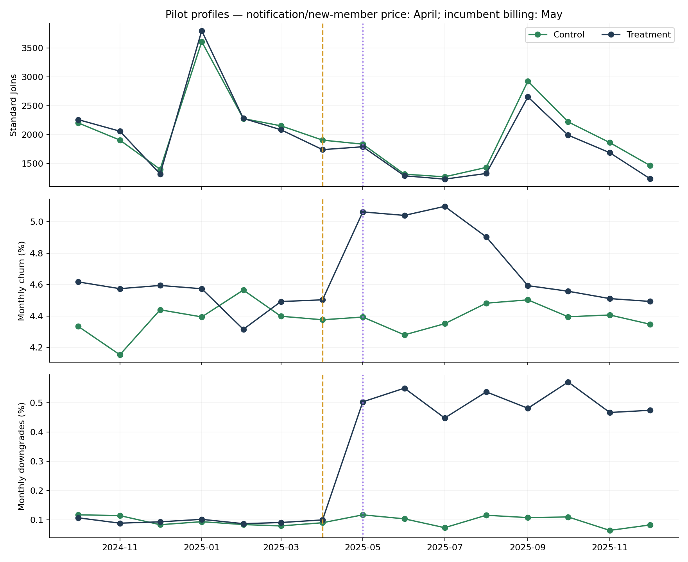
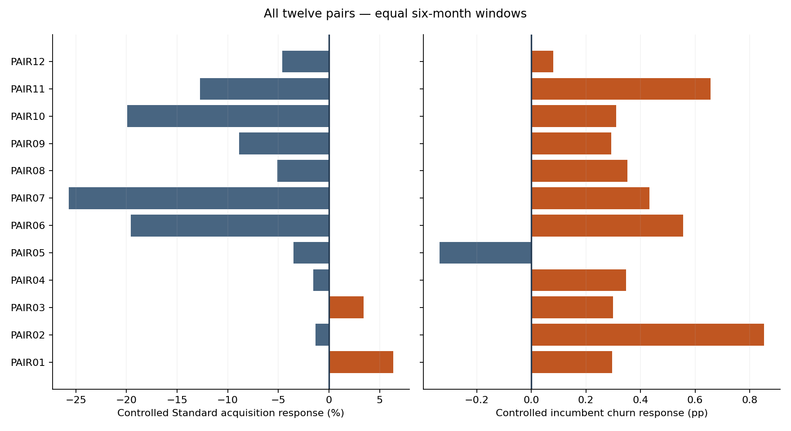
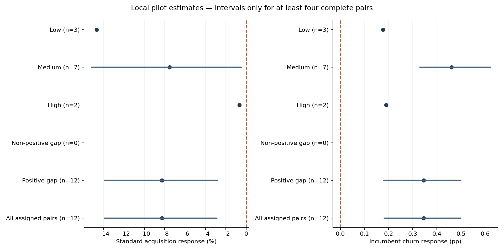

# Northstar Fitness — historical price response

This project uses synthetic data and is inspired by the commercial economics of UK subscription fitness businesses.

This project uses synthetic data created for portfolio purposes. It is inspired by the economics of multi-site subscription fitness businesses and does not use confidential information from The Gym Group or any other operator.

The April +£2 pilot supplies a local historical policy estimate from all twelve original randomised pairs. Standard acquisition, incumbent cancellations and tier downgrades are separate responses. The October 2024–March 2025 baseline and April–September 2025 follow-up each contain six months. No future price scenario, headroom reranking or pricing action is produced.

## What the evidence says

Controlled Standard acquisition response: **-8.266 (95% interval -13.901 to -2.889)%**. Approximate acquisition elasticity: **-1.120 (95% interval -1.902 to -0.384)**. The exact paired-assignment acquisition p-value is 0.01660.

Incumbent Standard monthly churn changed by **0.345 (95% interval 0.182 to 0.497) percentage points**, with exact assignment p-value 0.00342. Downgrades changed by **0.324 (95% interval 0.294 to 0.356) percentage points**. Site conversion changed by -1.510 (95% interval -2.700 to -0.471) pp; prospects are all-tier, so Standard conversion is unavailable.

Estimated cumulative total net revenue difference across the twelve treated gyms is **£217,436.413 (95% interval 151,026.190 to 289,220.130)**, versus a control-derived counterfactual for the historical six-month period. Net subscription revenue difference is £235,805.549 (95% interval 164,043.082 to 321,814.931). Standard yield changed by £1.380 (95% interval 1.330 to 1.430) per member-month, while total ARPMM changed by £0.870 (95% interval 0.800 to 0.938). These are revenue measures; costs and profit are not modelled.

Observed post-window context: treatment: 14,960 all-tier joins, 66,919 April opening members to 63,225 September closing members, £8,385,651 observed net subscription revenue; control: 15,533 all-tier joins, 67,604 April opening members to 65,483 September closing members, £8,151,328 observed net subscription revenue. These raw arm totals reflect different starting sizes and do not replace pair-controlled estimates. Eligible incumbent treatment paid rate averages £26.10 gross, with 81.0% of opening exposure already repriced and 0.1% still promotion-protected across the post window. Complaints increased by 0.946 (95% interval 0.786 to 1.109) per 1,000 average-member months on the controlled comparison.

## Mixed evidence and uncertainty

10 of twelve pairs show a negative controlled Standard acquisition response; 11 show higher incumbent churn. Every assigned pair remains in the primary result. Individual pairs are noisy; uncertainty and p-values do not provide rollout rules.

Early three-month, sustained nine-month, fixed pre-acquisition weights, leave-one-pair-out, pre-intervention placebo and competitor-entry exclusions are disclosed in the estimates interface. Pair groups use contemporaneous pre-event gaps and competitor counts. Regions contain one or two pairs each: regional estimates are descriptive and their intervals remain blank. Groups need four complete pairs for bootstrap intervals. Phase 4 segments are retrospective context and do not define causal response subgroups.

| Estimator / window | Acquisition response | Churn response (pp) | Estimated / weighted revenue difference |
| --- | ---: | ---: | ---: |
| paired_equal / primary_6m | -8.27% | 0.345 | £217,436 |
| fixed_pre_acquisition_weights / primary_6m | -7.47% | 0.334 | £229,048 |
| exclude_post_entry_pairs / primary_6m | -8.27% | 0.345 | £217,436 |
| paired_equal / early_3m | -6.49% | 0.552 | £103,482 |
| paired_equal / sustained_9m | -11.84% | 0.245 | £304,737 |
| paired_equal / placebo_3m | -1.76% | -0.318 | £8,855 |

The weighted monetary sensitivity is pair count × fixed-weight mean increment; it reweights site composition and is not a sum of actual site cashflows. Primary monetary results sum the twelve treatment-site counterfactual increments. Leave-one-pair-out acquisition responses range from -9.49% to -6.49%. There are 0 primary pairs with post-window competitor entry, so the entry-exclusion sensitivity retains all pairs. Different bootstrap draws can give slightly different interval endpoints for the same retained population. All twelve pairs have positive average pre-period competitor gaps: the non-positive group has no observations and its estimates remain unavailable. High competition has two pairs, Medium seven, Low three; only Medium supports a subgroup interval. These data do not establish a reliable difference between competitor-intensity groups.

Balance diagnostics: Matching: maximum absolute standardised difference 0.349; Primary baseline: maximum absolute standardised difference 0.261. The pre-period churn placebo is adverse in the opposite direction, with its interval just including zero. This imbalance and the selected pilot sample limit how confidently the effect can be transported to other sites. The primary post window retains 18 competitor cuts and 50 promotion events across assigned gyms. Treatment marketing changed from £360,922 to £304,580; control marketing from £358,124 to £294,350. Seasonality and contemporaneous changes remain visible rather than being removed after observing outcomes.

The twenty commercially selected increases use up to three nearest never-repriced same-region controls, with pre-event standardised characteristics. Controls may be reused. Matching distance and candidate counts are disclosed for every event. All selected events have 3–3 same-region controls; mean standardised matching distances range from 2.229 to 5.273. Larger distances indicate weaker observed comparability; there is no invented quality pass threshold. Descriptive results: TARGETED_202407: mean controlled acquisition -0.22%, mean churn difference 0.119 pp, and summed control-derived revenue difference £173,446; TARGETED_202502: mean controlled acquisition -13.77%, mean churn difference 0.452 pp, and summed control-derived revenue difference £189,746. These are observational comparisons: commercial selection, concurrent marketing, competitor changes and unobserved differences may explain part of the response. They are never pooled with the randomised evidence.

## What Phase 6 can learn

The pilot identifies a plausible acquisition response around one observed +£2 policy and separate monthly incumbent churn and downgrade responses, with intervals. It does not establish an estate-wide demand curve, precise per-gym elasticities, annual retention or future profit. Phase 6 should propagate the uncertainty and test acquisition and incumbent responses separately, respecting delayed billing and promotional protection.

Profiles show seasonality and delayed incumbent billing; raw arm trends are not controlled causal effects. April marks notification/new-joiner price and May marks eligible incumbent billing.

Pair responses expose adverse and heterogeneous observations; individual pair estimates lack sufficient replication for standalone causal conclusions.

Intervals and sample sizes show how little subgroup evidence supports precise conclusions. Missing intervals mean insufficient complete pairs, not zero uncertainty.

## Delivery and reconciliation

5,760 event-family panel rows, 32 repriced-event rows, 36 pilot pair/window rows and 372 estimate rows are delivered. The panel repeats each gym-month three times for different event eligibility definitions; stocks and revenues must not be summed across families. Member stocks and member-month exposure are not unique customers.

All 290 Python checks passed. Source, generation configuration, baseline and headroom hashes are unchanged. See response_validation.md and response_workbook_verification.json for independent saved-workbook evidence; workbook completion is recorded only after recalculation and visual review.

## Saved workbook completion evidence

Phase 5 is complete; the dataset and response estimates are ready for Phase 6. The workbook contains 21 populated sheets, preserving all 18 prior sheets, original styles, tables and chart resources except explicitly updated progress guidance. All 574,168 delivered CSV cells match the independently decoded saved workbook; the largest difference is 0.00000479, below the documented precision tolerance and below £0.01 for monetary values. 70,527 new formula caches are present, and the full recalculated workbook error scan found zero entries. Original source reconciliations and four representative input-change tests passed. All four CSVs reproduce byte-for-byte.

Visual review covers all three new sheets, three affected guidance sheets, five editable native charts and three standalone figures. Native subgroup dots display means and interval endpoints; the report forest figure connects the actual intervals. Recalculation uses Artifact Tool, with independent saved-OOXML checks; native Excel was not automated. Revenue is not profit, monthly exposure is not annual retention, repeated stocks are not unique customers, and the historical local policy estimate is not an estate forecast.
