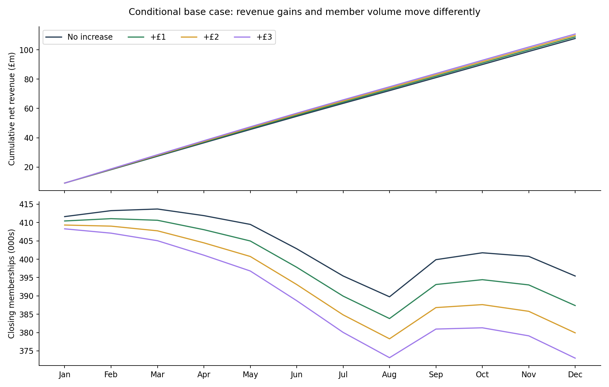
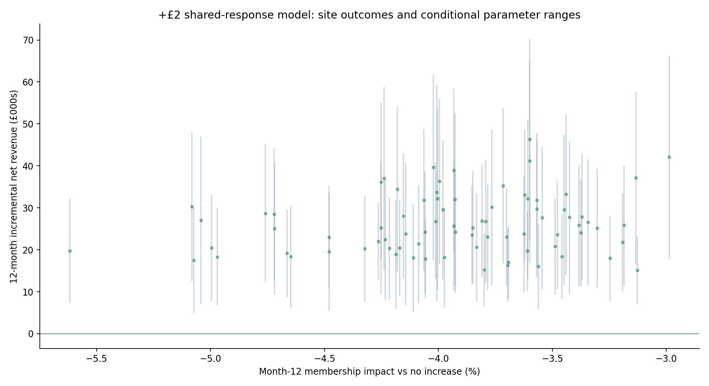
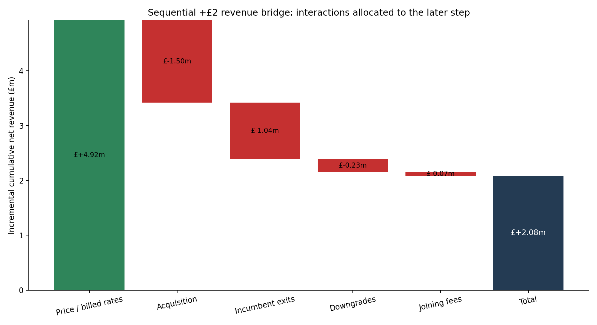

# Northstar Fitness — twelve-month pricing scenarios

This project uses synthetic data and is inspired by the commercial economics of UK subscription fitness businesses.

This project uses synthetic data created for portfolio purposes. It is inspired by the economics of multi-site subscription fitness businesses and does not use confidential information from The Gym Group or any other operator.

Phase 6 models conditional January–December 2026 revenue and expected memberships. The shared historical pilot response is transported across the estate; no site actions, rollout thresholds or headroom reranking are produced.

## What the calculated scenarios show

| Price option | Base net revenue | Increment vs no increase | Conditional 95% parameter range | Month-12 members | Member impact |
|---|---:|---:|---:|---:|---:|
| No increase | £107,728,047 | £0 | £0 to £0 | 395,423.4 | 0.00% |
| +£1 | £108,784,675 | £1,056,628 | £436,375 to £1,659,714 | 387,365.2 | -2.04% |
| +£2 | £109,811,489 | £2,083,442 | £876,898 to £3,278,666 | 379,919.6 | -3.92% |
| +£3 | £110,810,867 | £3,082,820 | £1,328,167 to £4,860,136 | 373,019.9 | -5.67% |

Starting memberships are 396,311. These are member stocks and fractional expected forecasts, not unique customers. The counterfactual already contains observed Q4 trading conditions and historical repricing; it is not a reconstructed never-repriced estate.

## Why the interpretation matters

January net revenue is lower before incumbent billing changes: the base +£2 difference is −£17,978. All 80 base +£2 site revenue differences are positive, but all have fewer members than no increase. This does not establish robustness to future shocks.

Higher billed yield can outweigh weaker recruitment and more exits over this horizon. Revenue excludes VAT under the existing 20% modelling convention, includes joining fees and separately disclosed ancillary income, and does not measure profit. Acquisition elasticity acts on Standard joins only. Incumbent churn and downgrades act on the continuing pre-2026 Standard risk set. Monthly retention is one minus exposure-weighted monthly churn, not annual customer retention.

The price-response curve is an assumption around one historical +£2 policy. Thirty-one current sites have non-positive December competitor gaps and 32 have already been repriced. The pilot included only positive pre-period competitor gaps, had pre-trend imbalance, and supplies no reliable per-site elasticity. Applying it to non-positive gaps, repeat repricing and +£1/+£3 is extrapolation. December run-rate ×12 is seasonal and distinct from earned annual revenue.

## Cases and uncertainty

Base uses primary equal-pair estimates. Downside and upside are coherent whole-pair bootstrap parameter vectors nearest estate +£2 revenue percentiles 10 and 90. They are used unchanged across sites and prices; they need not be every site’s individual downside or upside. Ten thousand samples use seed 20261006. The same sampled vector drives every gym and price, preserving common-response uncertainty. Ranges omit future demand shocks, competitor reaction and uncertain transport. The fraction of parameter draws with positive revenue is not a rollout probability.

## Sensitivities

| Alternative | +£2 estate increment | Month-12 member impact |
|---|---:|---:|
| early_3m | £1,663,140 | -4.60% |
| sustained_9m | £1,707,909 | -4.43% |
| fixed_acquisition_weights | £2,242,133 | -3.68% |
| zero_behaviour | £4,924,248 | 0.00% |
| future_joiner_churn | £1,970,826 | -4.19% |
| offpeak_diversion | £2,378,620 | -3.34% |
| member_sensitive_ancillary | £2,025,300 | -3.92% |

The future-joiner, 25% diversion and member-sensitive ancillary variants are illustrative assumptions, not estimated causal effects. Early/sustained coefficients use their own historical timing calibration. No adverse observation is removed to improve results.

## Break-even and trading context

The teaching old/new retention ratio applies only to a uniformly affected subscription group. The model break-even scales acquisition, incumbent churn and downgrades jointly from zero to 64 times their primary response. The first crossing and total crossing count are disclosed; no crossing means unavailable. This is a response-stress margin, not an allowable estate churn threshold. The 80 base +£2 sites each have one detected crossing; multipliers range 1.61–1.99 and their member impacts at break-even range −9.27% to −5.19%. Aggregate estate roots are not evaluated. There are no baseline-estimation fallbacks or probability caps in the primary cases.

## Commercial visuals

This reveals when yield gains and member losses accumulate; it does not validate future demand.

This identifies sites needing closer assumption review. Vertical ranges reflect shared pilot parameter uncertainty, not independently estimated site effects.

The exact bridge introduces billed-rate changes, acquisition response, incumbent exits, downgrades, then joining fees. Interactions belong to the later step. Ancillary revenue is equal in the main scenarios. The ordering is an accounting allocation, not separate causal attribution.

## Delivery and verification

11,520 monthly rows, 960 site/case rows, 12 estate/case rows and 2,268 sensitivity rows. All 1,500 Python checks passed. Input hashes are unchanged. The 25-sheet workbook passes saved-formula recalculation, independent source/CSV parity, all-twelve comparison refresh, freshness and override tests, formula-error scanning and visual review. All 21 earlier sheets and native features are preserved; only progress text changes on the two guidance sheets. Detailed evidence: scenario_workbook_verification.json.

Remaining simplifications include fixed competitor prices and visit intensity, no new tier upgrades, cash collection, bad debt or contribution costs, and midpoint billing exposure. At +£3, Standard equals the unchanged Plus headline at 20 sites previously raised by +£2; possible upgrades and changes in the Plus value proposition are not identified or modelled.

Phase 7 can use the quantified trade-offs and explicit uncertainty to develop conditional site recommendations; Phase 6 assigns none.
