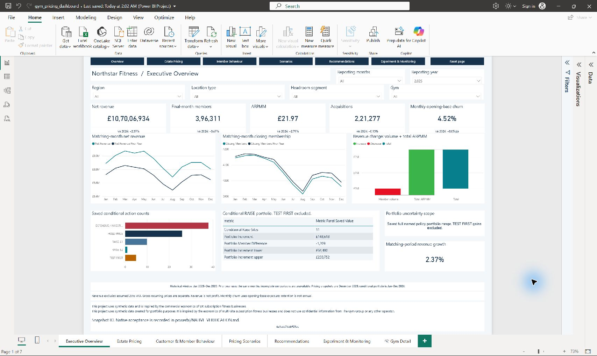
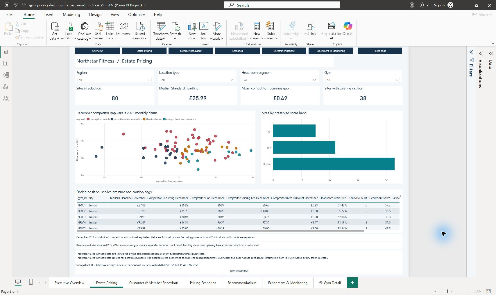
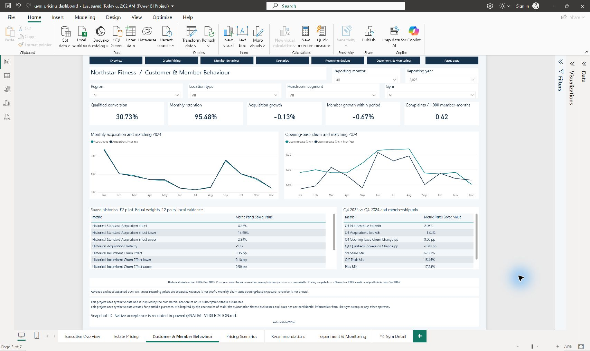
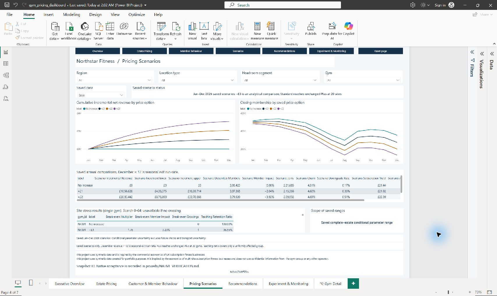
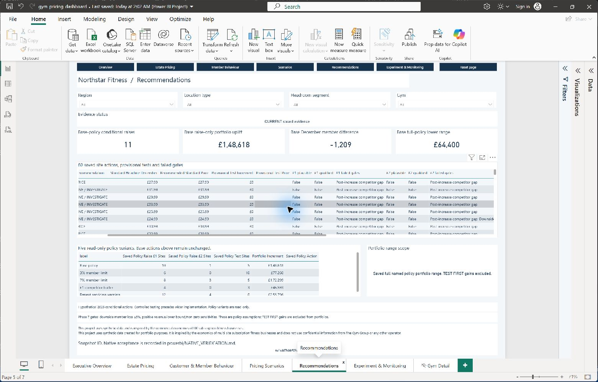
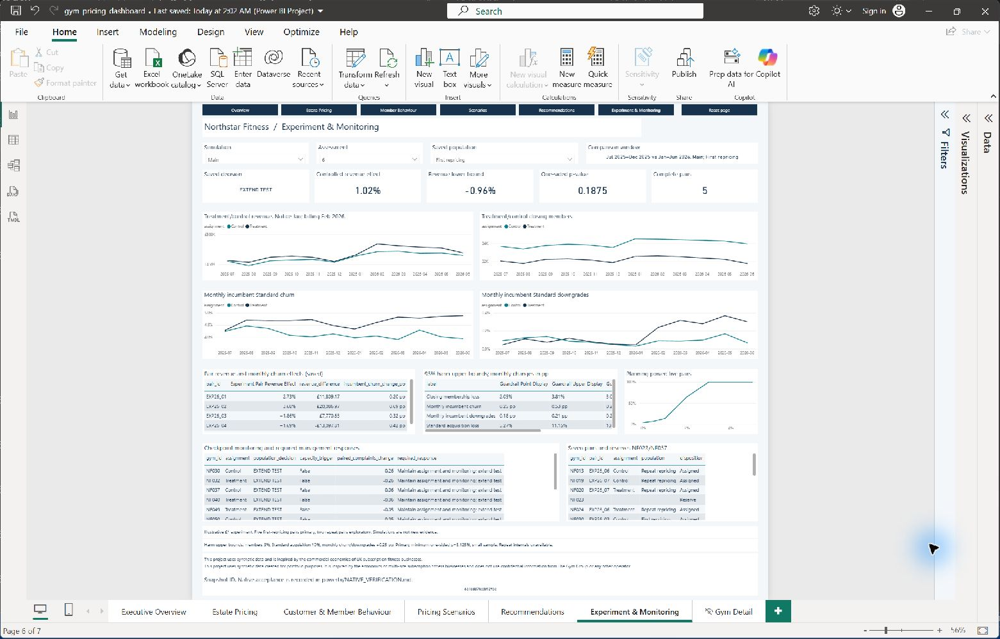
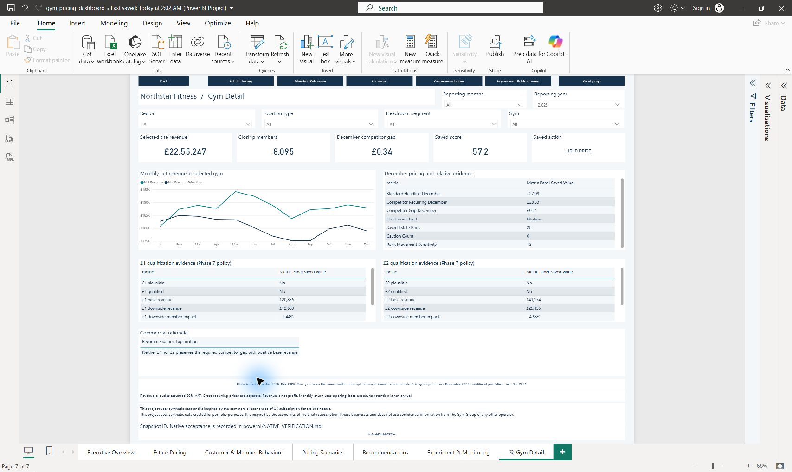

# Native Power BI dashboard gallery

These are native Desktop captures, not design previews. All seven layouts and interactions passed the [recorded acceptance](../analysis/powerbi_native_acceptance.json). Screenshots show the captured viewport; scrollable tables contain additional rows in the PBIX.

## Executive Overview

2025 trading and exact volume/ARPMM bridge.

## Estate Pricing

December 2025 price snapshots and original headroom evidence.

## Customer & Member Behaviour

Weighted acquisition, churn and historical policy response.

## Pricing Scenarios

Saved combinations; controls do not rerun forecasts.

## Recommendations

Saved conditional actions and qualification evidence.

## Experiment & Monitoring

Main simulation, six months, five first-repricing pairs: EXTEND TEST.

## Gym Detail

NF001 drill-through with trading and recommendation rationale.

Separate `images/powerbi_p*.png` files are design previews, not native Power BI screenshots.
